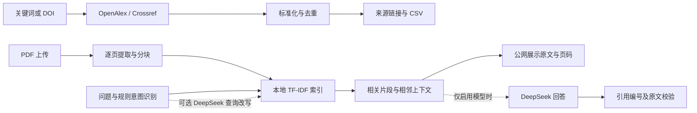

# Research AI Copilot｜科研 AI 智能助手

[**在线体验 →**](https://nightsci-research-ai-copilot.streamlit.app/) · [GitHub 源码](https://github.com/nightsci/research-ai-copilot)

**已上线：多源学术检索 + PDF 原文证据检索。** 公网未配置 DeepSeek 密钥，暂不提供生成式回答或模型翻译；这是有意控制费用的演示模式，并非故障。

**实际架构：** Python 3.12 / Streamlit → OpenAlex + Crossref；pypdf 逐页解析 → 分块 → scikit-learn TF-IDF + 余弦相似度 → 原文与页码。可选 DeepSeek OpenAI 兼容 HTTP 接口负责查询改写与回答生成，再校验引用。

**验证记录：** 本次收尾回归 78 项离线自动化测试通过（2026-10-29，12.45 秒），含无密钥提示、生成禁用、证据检索及不调用模型的检查；历史真实 DeepSeek 中文问答有 5 条通过核验的引用，无关问题拒答有 2 条主题引用。云端检索、上传与证据功能由项目作者验收正常。详见 [检查报告](docs/DEPLOYMENT_CHECK.md)，离线测试不等于真实接口测试。

面向科研初学者的文献发现与论文阅读工具，也是一个可演示的 AI 产品工程作品集。入口：**research-ai-copilot.py**，推荐 Python **3.12**。

## 体验范围

| 能力 | 公网在线演示 | 本地模型模式 |
|---|---|---|
| OpenAlex / Crossref 检索、DOI、筛选、去重与 CSV | 已开放 | 可用 |
| PDF 上传、文字提取、TF-IDF 证据检索与物理页码 | 已开放 | 可用 |
| 中文问题查询英文论文 | 请加入论文中的英文关键词；跨语言召回有限 | DeepSeek 查询改写已验证 |
| 生成中文答案与逐条引用校验 | 暂未开放 | 已通过真实模型调用验证 |
| 无依据处理 | 提示证据不足并展示主题候选；不据此断言全文不存在 | 支持模型辅助研究范围核查与拒答 |

体验路径：先搜索 `polysilazane corrosion coating` 并打开来源链接；再切换科研问答页，上传你有权使用的文字版 PDF，点击“提取文字并建立索引”，输入论文中的关键词并点击“检索原文证据”。不要上传私人或涉密论文。

## 真实 AI 问答演示视频（待提供）

**视频尚未提供，此处没有虚构链接或截图。** 后续在此放置经隐私检查的真实录屏：上传授权论文 → 中文提问 → 显示真实 DeepSeek 回答 → 对照 PDF 页码及摘录 → 无关问题拒答。录屏需注明本地模型模式、模型名称和录制日期，隐藏凭据、账户信息及私人文件路径。该视频用于展示公网暂未开放的能力。

## 产品背景与用户痛点

科研选题与阅读需要在多个数据库之间切换，重复整理文献；阅读英文论文时，又常常难以定位实验方法、参数和答案出处。本项目把“发现论文 → 上传 PDF → 定位证据 → 核验回答”连接成一个清晰流程，帮助用户保留可追溯的阅读依据。

## 已实现功能

- **多源学术检索**：OpenAlex / Crossref 真实 API、关键词与 DOI 查询、年份及本次结果内期刊筛选、去重和 CSV 导出。
- **论文问答**：逐页 PDF 文字提取、TF-IDF 向量检索、中文问题英文改写、摘要/实验/数据/推理意图路由、相邻上下文补充。
- **可追溯回答**：DeepSeek 生成结构化回答；每条结论映射到真实文件、物理页码和原文摘录，逐字校验引用。
- **无答案处理**：保留证据不足拒答，必要时核查已解析全文的研究范围；不推断图片或无法提取内容不存在。
- **故障降级**：无模型密钥时仍可检索文献、提取 PDF 和检索原文；上游超时、认证失败、余额不足有明确提示。

## 技术架构



`scholar/` 负责学术接口和检索页面，`rag/` 负责 PDF、检索、模型调用与引用校验，`tests/` 为离线自动化测试，`scripts/` 提供真实接口验收及安全扫描。不依赖复杂 Agent 框架或外部向量数据库。

## 本地运行（Windows PowerShell）

先安装 Python 3.12，然后在本目录运行：

```powershell
py -3.12 -m venv .venv
.\.venv\Scripts\python.exe -m pip install -r requirements-dev.txt
.\.venv\Scripts\python.exe -m streamlit run research-ai-copilot.py
```

打开 http://localhost:8501。不要使用不存在的 `app.py`。无需先激活虚拟环境；如端口占用，可追加 `--server.port 8506`。

## 配置模型和 Secrets

不需要密钥即可体验学术检索和原文证据。需要在本地生成回答时，在本机 `.env` 或 `.streamlit/secrets.toml` 中填写自己的凭据。当前公网保持无模型密钥；将来受控演示使用服务端 Secrets，不把实际凭据放入仓库。

```toml
LLM_API_KEY = "在平台 Secrets 中填写，不要写入本 README"
LLM_MODEL = "deepseek-flash"
LLM_BASE_URL = "https://api.deepseek.com"
LLM_TIMEOUT = "60"
LLM_JSON_MODE = "true"
LLM_TOKEN_PARAMETER = "max_tokens"
```

可选配置 `OPENALEX_API_KEY`、`CROSSREF_MAILTO`。配置优先级为系统环境变量 → 本目录 `.env` → Streamlit Secrets；不会搜索父目录 `.env`。修改密钥后重启应用。模板为 `.env.example` 与 `.streamlit/secrets.toml.example`，模板必须保持无真实密钥。

## 公开演示与费用

- “调用模型生成回答”默认不勾选，用户主动勾选才调用模型。无密钥展示不会产生模型费用。
- 一次问答可能包含查询改写、回答生成、一次引用重试及范围核查。范围核查最多发送 90000 字符已提取全文，可能明显增加费用。
- 文档在服务器当前会话内处理；启用生成后会发送问题、证据片段或范围核查所需文本给配置的模型服务。不要上传私人、涉密或未经授权的科研资料。
- 本版**没有账户鉴权、全局限流和服务端硬预算**。只要为公开网站配置共享密钥，访客就可能消耗额度；不建议直接以无限额共享密钥公开运行。作品集可先公开无密钥证据模式，模型演示使用访问受限的部署及低额度专用密钥。
- 本项目没有自动设置服务商额度，也不承诺调用费用为零。

后续开放模型功能前，按 [受控 AI 演示方案](docs/CONTROLLED_AI_DEMO.md) 实现服务端授权、持久化共享额度和预算预留。**目前仅完成设计，未实现这些控制，也未配置真实密钥。**

## 上传限制和已知限制

每文件 20 MB、最多 200 页；一次最多 3 个文件，总计 30 MB；单文档文字上限 100 万字符，合计 150 万字符。支持损坏、加密、扫描版和超限提示。服务器上传入口也限制为 20 MB。

目前不支持 OCR、复杂表格/公式/图片理解，也没有隔离 PDF 解析进程。TF-IDF 是词项向量，跨语言依赖查询改写，召回并非完备。意图和章节候选采用轻量规则；引用存在不保证推理完全正确，尤其应核对作者假设与实验结论。无持久化知识库或完整聊天历史。

## 测试与可复核记录

```powershell
.\.venv\Scripts\python.exe -m pytest -q -p no:cacheprovider
.\.venv\Scripts\python.exe -m scripts.audit_release
.\.venv\Scripts\python.exe -m scripts.smoke_live
```

前两项离线运行；第三项真实访问学术 API。真实论文问答脚本 `scripts/verify_release.py` 接受外部 `--pdf`、`--question`、`--unrelated` 参数，使用实际配置调用模型，可能收费。测试夹具仅用于自动化测试，不冒充真实论文或真实模型回答。

验收结果和未通过项见 [部署检查报告](docs/DEPLOYMENT_CHECK.md)。报告仅保留统计与状态，不附用户 PDF、全文或实际凭据。

## GitHub 与 Streamlit Cloud

项目已上传 [GitHub](https://github.com/nightsci/research-ai-copilot)，并部署到 [Streamlit Cloud](https://nightsci-research-ai-copilot.streamlit.app/)。部署分支为 `main`，入口为 `research-ai-copilot.py`；本地已验证 Python 3.12，云端运行版本以管理后台为准。公网不配置模型密钥。后续维护见 [GitHub 更新指南](docs/GITHUB.md)。[官方部署说明](https://docs.streamlit.io/deploy/streamlit-community-cloud/deploy-your-app/deploy) · [Secrets 管理](https://docs.streamlit.io/deploy/streamlit-community-cloud/deploy-your-app/secrets-management)
